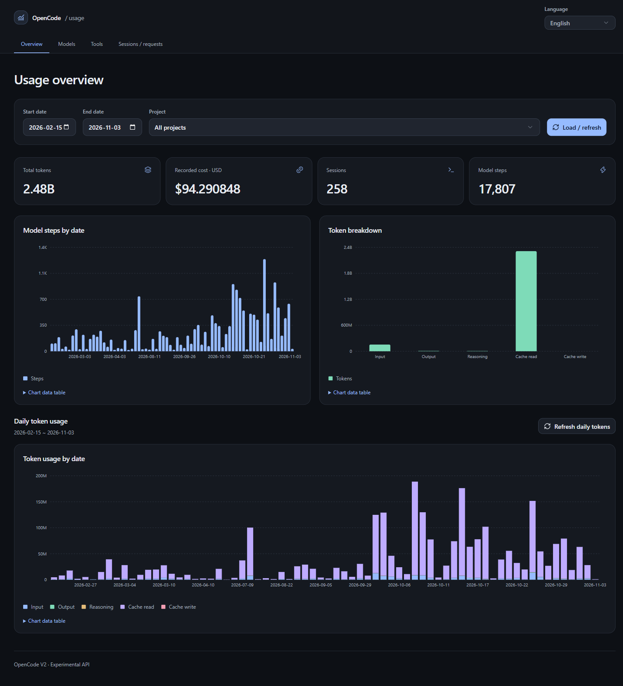

# OpenCode Usage Dashboard

<p align="center">
  <a href="README.md">English</a> |
  <a href="README.zh.md">简体中文</a> |
  <a href="README.zht.md">繁體中文</a> |
  <a href="README.ko.md">한국어</a> |
  <a href="README.de.md">Deutsch</a> |
  <a href="README.es.md">Español</a> |
  <a href="README.fr.md">Français</a> |
  <a href="README.it.md">Italiano</a> |
  <a href="README.da.md">Dansk</a> |
  <a href="README.ja.md">日本語</a> |
  <a href="README.pl.md">Polski</a> |
  <a href="README.ru.md">Русский</a> |
  <a href="README.bs.md">Bosanski</a> |
  <a href="README.ar.md">العربية</a> |
  <a href="README.no.md">Norsk</a> |
  <a href="README.br.md">Português (Brasil)</a> |
  <a href="README.th.md">ไทย</a> |
  <a href="README.tr.md">Türkçe</a> |
  <a href="README.uk.md">Українська</a> |
  <a href="README.bn.md">বাংলা</a> |
  <a href="README.gr.md">Ελληνικά</a> |
  <a href="README.vi.md">Tiếng Việt</a>
</p>

Lekkie, lokalne zestawienie internetowe dla **OpenCode V2**, które pozwala analizować w przeglądarce zużycie tokenów, koszty modeli, wydajność narzędzi oraz kontekst sesji dla poszczególnych żądań.

Aby otworzyć panel, uruchom **`/usage-dashboard`** w OpenCode Mini lub pełnym TUI. Działa on w procesie wtyczki OpenCode i nie wymaga dodatkowej bazy danych ani demona działającego w tle.



## Co możesz sprawdzić

- **Przegląd (`/stats`):** Łączna liczba tokenów, zarejestrowany koszt w USD, sesje, Steps modeli, aktywność dzienna, podział tokenów oraz trendy dzienne wczytywane na żądanie.
- **Modele (`/models`):** Wykresy i tabele tokenów oraz kosztów według dostawcy, modelu i wariantu — z sortowaniem według tokenów, kosztu, Steps lub nazwy modelu.
- **Narzędzia (`/tools`):** Liczba wywołań, liczba sukcesów, niepowodzeń i nieukończonych wywołań oraz mediana (`P50`) czasu wykonania dla każdego narzędzia.
- **Sesje i kontekst żądań (`/sessions`):** Wyszukiwanie sesji według tytułu, przechodzenie między sesjami nadrzędnymi i podrzędnymi, przegląd osi czasu tokenów i kosztów dla poszczególnych żądań oraz zapisanej historii poprzedzającej wybrany krok.

## Szybki start

Dodaj wtyczkę do pliku `opencode.json`:

```json
{
  "$schema": "https://opencode.ai/config.json",
  "plugins": ["github:createOne999/opencode-usage-webui#release"]
}
```

Następnie uruchom **`/usage-dashboard`** w OpenCode, aby otworzyć panel w domyślnej przeglądarce, albo przejdź bezpośrednio pod adres <http://127.0.0.1:7331/stats> (`http://localhost:7331/stats` oraz `http://[::1]:7331/stats` również działają).

### Zmiana portu

Domyślny port to `7331`. Jeśli uruchamiasz jednocześnie wiele projektów lub chcesz użyć innego portu, ustaw `options.port` (wartość `0` automatycznie wybiera dowolny dostępny port):

```json
{
  "$schema": "https://opencode.ai/config.json",
  "plugins": [
    { "package": "github:createOne999/opencode-usage-webui#release", "options": { "port": 7332 } }
  ]
}
```

## Korzystanie z panelu

- **Filtry daty i projektu:** Domyślnie ustawiany jest bieżący miesiąc i bieżący projekt, zgodnie ze strefą czasową przeglądarki (data końcowa jest wliczana). W dowolnej chwili możesz przełączyć się na **Wszystkie projekty** lub wybrany projekt.
- **Interfejs w wielu językach:** Zmień język za pomocą selektora u góry. Wybrany język (`?lang=...`), zakres dat, filtr projektu i aktywne łącze do żądania pozostają w adresie URL, dzięki czemu możesz łatwo dodać dowolny widok do zakładek lub go odświeżyć.
- **Dzienny podział tokenów:** Na stronie Przeglądu kliknij **Wczytaj dzienne tokeny**, aby zobaczyć wykresy dziennych tokenów wejściowych, wyjściowych, rozumowania oraz odczytu i zapisu pamięci podręcznej dla wybranego okresu.
- **Przeglądanie kontekstu żądań:**
  1. Otwórz **Sesje / żądania** i wybierz sesję (użyj odznaki lub sekcji **Sesje podrzędne**, aby przechodzić między powiązanymi sesjami podagentów).
  2. Kliknij punkt na wykresie żądań lub znacznik czasu w tabeli żądań.
  3. Przeglądaj **Zapisaną historię przed żądaniem** (w tym polecenia użytkownika, wcześniejsze odpowiedzi, wywołania narzędzi, umiejętności i podsumowania kompresji) obok **Odpowiedzi na wybrane żądanie**.
  4. W dowolnej chwili użyj opcji **Wczytaj 100 kolejnych wpisów historii**, aby przejrzeć wcześniejsze wiadomości z długiej sesji.

### Przydatne informacje o metrykach

- **Liczba tokenów:** Wyświetlana jest w skróconych jednostkach `K`, `M`, `B` i `T` (z dokładnością do dwóch miejsc po przecinku), natomiast sortowanie i sumy używają dokładnych wartości. Łączna liczba tokenów to `input + output + reasoning + cache.read + cache.write`.
- **Szacunkowe koszty:** Koszty są podawane w USD na podstawie użycia raportowanego przez dostawcę oraz stawek z katalogu modeli i służą jako orientacyjne informacje.
- **Widok zapisanego kontekstu:** Inspektor żądań odtwarza kontekst na podstawie zapisanej historii sesji i ukończonych granic kompresji aż do wybranego kroku.

## Lokalnie i prywatnie z założenia

- **Tylko interfejs loopback:** Panel nasłuchuje wyłącznie na lokalnych adresach loopback (`127.0.0.1` i `::1`) i weryfikuje nagłówki tego samego źródła, dzięki czemu dane o użyciu są dostępne tylko na Twoim urządzeniu.
- **Bez dodatkowego przechowywania danych i telemetrii:** Panel na żądanie odczytuje dane z uruchomionej lokalnie współdzielonej usługi OpenCode V2. Wszystkie zasoby interfejsu i tłumaczenia są dołączone lokalnie; nie korzysta on z zewnętrznych CDN-ów, analityki ani dodatkowych plików danych. Aby odinstalować wtyczkę, usuń jej wpis z `opencode.json`.

## Uruchamianie ze źródeł

Projekt jest przeznaczony dla OpenCode **2.2.0** i Bun **1.4.2**. W katalogu głównym repozytorium uruchom:

```powershell
bun run setup
opencode mini
# Inside OpenCode: /usage-dashboard
```

Jeśli pracujesz w środowisku zdalnym, WSL lub bez interfejsu graficznego, w którym przeglądarka nie może otworzyć się automatycznie, sprawdź aktywny adres panelu i jego gotowość w terminalu:

```powershell
bun run status
```

### Kontrole deweloperskie

```powershell
bun run build
bun run typecheck
bun run test
```

## Licencja

Licencja MIT. Szczegóły zawiera plik [LICENSE](LICENSE).
